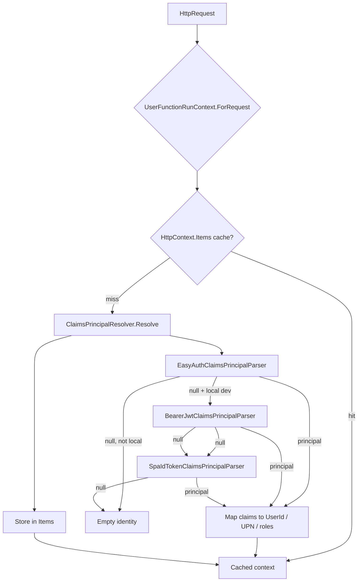

# Architecture — Function run context

## Purpose

`FunctionRunContext` types give Azure Functions HTTP triggers a **single, testable place** to read:

- who is calling (`GetUserId`, `GetUPN`, `IsAuthenticated`)
- app roles (`IsInAtLeastOneRole`, `IsInAllRoles`)
- whether the host runs in **explicit local-dev mode** (`IsDev`)
- JSON body (`GetPayLoad<T>`) on user contexts

Identity is **never** taken from ad-hoc headers without validation (except Easy Auth, which the platform injects after authentication).

## Resolution pipeline (user HTTP)

## Why three local JWT paths

| Path | When | Audience | Typical caller |
|------|------|----------|----------------|
| Easy Auth | Cloud (and local if configured) | Platform-validated | Function App with Authentication enabled |
| API Bearer | Local only | `FUNCTIONS_UTILS_AAD_AUDIENCE` | Postman, integration tests, MSAL API scope |
| SPA ID token | Local only | SPA client id (`FUNCTIONS_UTILS_AAD_SPA_CLIENT_ID`) | SPA calling local Functions without API access-token scope |

When a SPA omits API scopes against localhost, the host can validate the **ID token** (audience = SPA client id) instead of an access token whose audience is the protected API.

## Claim mapping (after principal exists)

Same rules for Easy Auth and validated JWT:

- **User ID:** `oid` → objectidentifier URI → `sub` → nameidentifier URI
- **UPN:** `upn` → UPN URI → `preferred_username` → `unique_name` → `email`
- **Roles:** all `roles` + `ClaimTypes.Role`

JWT validation uses `MapInboundClaims = false` so short Entra claim names match Easy Auth JSON.

## Caching semantics

- **`ForRequest`:** one `UserFunctionRunContext` per `HttpRequest` when `HttpContext.Items` is available (normal ASP.NET Core pipeline in isolated worker).
- **OIDC metadata:** one `ConfigurationManager` per tenant metadata URL in-process; first Bearer validation may block on metadata fetch (see `EntraJwtClaimsPrincipalParser` remarks).

## Application context

`AppFunctionRunContext` bypasses HTTP entirely: caller supplies application id and role array (timers, internal jobs, tests).

## Source layout (`FunctionRunContext/Internal/`)

All types stay in namespace `WebGate.Azure.FunctionsUtils.Internal.*` matching the folder (public API remains `WebGate.Azure.FunctionsUtils`).

| Folder | Responsibility |
|--------|----------------|
| `Environment/` | Local-dev flag (`AzureFunctionsEnvironment`) and Entra env vars for JWT (`LocalEntraJwtEnvironment`) |
| `EasyAuth/` | `EasyAuthClaimsPrincipalParser`, `ClientPrincipal`, `ClientPrincipalClaim`, `Base64Url` |
| `EntraJwt/` | Shared Entra JWT validation, API Bearer and SPA ID-token entry parsers |
| `Resolution/` | `ClaimsPrincipalResolver`, `ResolvedIdentity` |
